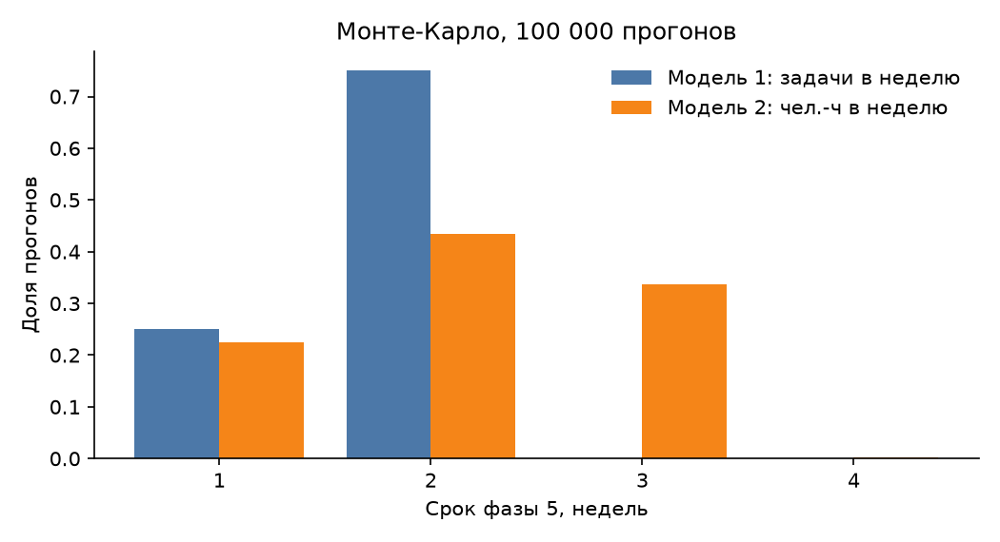

# Фаза 4 (мета). Прогнозирование

Фазы 4 и 5 связаны: здесь работа фазы 5 разбита на задачи и оценена, а по истории выполнения фаз 1–4 методом Монте-Карло спрогнозирован её срок. Основной расчёт — 100 000 прогонов на модель; тот же расчёт формулами — `Фаза 4.xlsx` (листы «Модель 1 (Excel)» и «Модель 2 (Excel)», по 2 000 прогонов, пересчёт — F9).

## 1. Декомпозиция фазы 5 и трёхточечные оценки

Оценки согласованы на общем митинге: каждый называл свою тройку «оптимистичная — наиболее вероятная — пессимистичная», крайние значения обсуждали и сходились на общей тройке. У митингов — сумма по трём участникам.

| Код | Задача | O, ч | M, ч | P, ч | Среднее треуг., ч |
|---|---|---|---|---|---|
| F1 | Декомпозиция проекта EventPass на работы (20–25) | 2 | 3 | 5 | 3.33 |
| F2 | Состав команды и типы ресурсов | 1 | 1.5 | 3 | 1.83 |
| F3 | Длительности и ресурсные требования работ | 2 | 3 | 5 | 3.33 |
| F4 | Связи предшествования, сетевой график | 1.5 | 2 | 4 | 2.5 |
| M3 | Митинг: согласование работ, ресурсов и связей (3 × 1 ч) | 2.25 | 3 | 4.5 | 3.25 |
| F5 | Подготовка входных данных и кода эвристик | 2 | 3 | 6 | 3.67 |
| F6 | Расчёт по 12 эвристикам и случайным приоритетам, выбор лучшего | 2 | 4 | 7 | 4.33 |
| F7 | Календарный план на 40-часовую неделю, сроки этапов | 1.5 | 2.5 | 4 | 2.67 |
| F8 | Анализ результатов и выводы | 1 | 2 | 3 | 2 |
| F9 | Оформление фазы 5, итоговый отчёт, актуализация RACI | 2 | 3 | 5 | 3.33 |
| M4 | Митинг: подготовка к защите (3 × 1 ч) | 1.5 | 3 | 4.5 | 3 |
|  | **Всего** | **18.75** | **30** | **51** | **33.25** |

Среднее треугольного распределения — $(O+M+P)/3$. Сумма средних 33.25 ч больше суммы наиболее вероятных 30 ч: оценки скошены вправо (до пессимистичной дальше, чем до оптимистичной).

## 2. История выполнения

Источник — матрица RACI фаз 1–3 и задачи фазы 4, завершённые до прогноза. Неделя — с понедельника. Задача засчитывается в неделю, на которую приходится её окончание; часы задачи делятся поровну по дням её периода. Берутся полные недели до 15.11.

| Неделя | Завершено задач | Чел.-ч |
|---|---|---|
| 19.10–25.10 | 7 | 20 |
| 26.10–01.11 | 6 | 11.75 |
| 02.11–08.11 | 11 | 36 |
| 09.11–15.11 | 7 | 16 |
| **Всего** | **31** | **83.75** |

В среднем 7.75 задачи и 20.94 чел.-ч в неделю, 2.7 ч на задачу. Каждое из 4 значений считаем равновероятным — это и есть дискретные распределения для двух моделей.

## 3. Модель 1: число задач в неделю

Прогон: пока не закрыты все 11 задач фазы 5, сэмплируем число закрытых за неделю задач из распределения истории и прибавляем неделю.

| Недель | Прогонов | Доля | Накопленная |
|---|---|---|---|
| 1 | 25014 | 25.0% | 25.0% |
| 2 | 74986 | 75.0% | 100.0% |

**С достоверностью 80% фаза 5 займёт не больше 2 нед.**

## 4. Модель 2: человеко-часы в неделю

Прогон: длительность каждой задачи сэмплируем из треугольного распределения $(O, M, P)$, суммируем; затем сэмплируем ёмкость недели (сколько чел.-ч команда уделила предмету) из истории, пока суммарная ёмкость не покроет трудозатраты.

Суммарные трудозатраты фазы 5: среднее 33.2 ч, 10-й перцентиль 30.6 ч, 90-й — 36 ч.

| Недель | Прогонов | Доля | Накопленная |
|---|---|---|---|
| 1 | 22488 | 22.5% | 22.5% |
| 2 | 43457 | 43.5% | 65.9% |
| 3 | 33757 | 33.8% | 99.7% |
| 4 | 298 | 0.3% | 100.0% |

**С достоверностью 80% фаза 5 займёт не больше 3 нед.** Если считать последнюю неделю дробной (доля её ёмкости, которая реально понадобилась), 80-й перцентиль — 2.17 нед.

## 5. Сравнение моделей

|  | Модель 1 | Модель 2 |
|---|---|---|
| Что сэмплируется | задач в неделю | длительности задач и чел.-ч в неделю |
| Срок с достоверностью 80% | **2 нед.** | **3 нед.** |
| Вероятность уложиться в 1 неделю | 25% | 22% |
| Вероятность уложиться в 2 недели | 100% | 66% |

Чем объясняется разница:

- **Порог двух недель.** Самая слабая неделя истории — 6 задач, значит любые две недели дают не меньше 12 задач, а нужно 11. Поэтому модель 1 не может дать больше двух недель. В часах всё иначе: самая слабая неделя — 11.75 ч, и 6 из 16 пар недель дают меньше 33 ч, которые нужны в среднем. Отсюда треть прогонов модели 2 на третьей неделе.

- **Модель 1 не видит размер задач.** Она считает все задачи одинаковыми. В истории на задачу приходится 2.7 ч, а задачи фазы 5 в среднем крупнее — 3.02 ч. В задачах фаза 5 — это 1.42 средней недели, в часах — 1.59: модель 1 недооценивает объём.

- **Неопределённость оценок влияет слабо.** Разброс суммарных трудозатрат небольшой (10–90-й перцентили — 30.6–36 ч): ошибки отдельных задач частично компенсируют друг друга. Основной разброс модели 2 даёт ёмкость недель.

- **Мало истории.** Распределения построены по четырём неделям, и у каждой своя специфика: неделя фазы 3 (36 ч, 11 задач) поднимает обе модели, неделя фазы 2 опускает. Модель 1 к тому же зависит от того, как работа нарезана на задачи (митинги и оформление — тоже задачи).

Для плана берём более осторожный прогноз — **3 нед.**: фаза 5 с 17.11 по 07.12.
