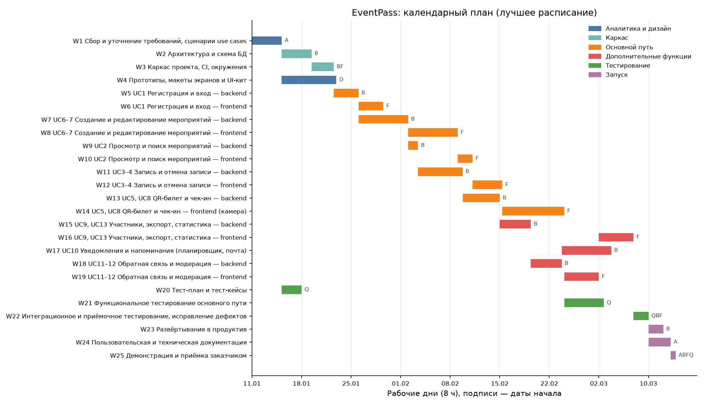

# Фаза 5. Планирование

Проект EventPass (фазы 1 и 3) разложен на 25 работ, для каждой указаны длительность, потребность в специалистах и предшественники. Расписание с ограниченными ресурсами построено эвристиками приоритетов: 12 правил из задания × 2 схемы генерации расписания и 2000 случайных приоритетов × 2 схемы. Данные и результаты — `Фаза 5.xlsx` (листы «Работы», «Эвристики», «План», «Гант»).

## 1. Команда и типы ресурсов

По выводам фазы 3 проекту нужно около 3 ставок: по одному backend- и frontend-разработчику, полставки тестировщика, по четверти ставки дизайнера и аналитика-менеджера. Для планирования каждая специализация — тип возобновляемого ресурса с запасом 1 человек: дизайнер, тестировщик и аналитик заняты не всё время, но одновременно работают максимум по одному.

| Код | Специализация | Запас, чел. | Загрузка по плану, ч |
|---|---|---|---|
| A | Аналитик-менеджер | 1 | 46 |
| D | UI/UX-дизайнер | 1 | 44 |
| B | Backend-разработчик | 1 | 294 |
| F | Frontend-разработчик | 1 | 236 |
| Q | Тестировщик | 1 | 64 |

Управление проектом (15 % в оценке фазы 3) идёт фоном через весь проект и отдельной работой в расписание не входит.

## 2. Работы, ресурсы и связи

Трудоёмкость use cases взята из покера фазы 3 (426 ч). Каждый use case — мелкие попарно — разделён на backend- и frontend-часть по экспертной оценке доли работ: frontend начинает после готовности API, а backend тем временем берёт следующую фичу. У работ с одним исполнителем длительность равна трудоёмкости. ES/LS — раннее и позднее начало без учёта ресурсов, в часах от старта.

| ID | Работа | Длит., ч | Ресурсы | Предшественники | ES | LS | Резерв |
|---|---|---|---|---|---|---|---|
| W1 | Сбор и уточнение требований, сценарии use cases | 24 | Аналитик-менеджер | — | 0 | 0 | 0 |
| W2 | Архитектура и схема БД | 24 | Backend-разработчик | W1 | 24 | 24 | 0 |
| W3 | Каркас проекта, CI, окружения | 18 | Backend-разработчик, Frontend-разработчик | W2 | 48 | 48 | 0 |
| W4 | Прототипы, макеты экранов и UI-кит | 44 | UI/UX-дизайнер | W1 | 24 | 148 | 124 |
| W5 | UC1 Регистрация и вход — backend | 20 | Backend-разработчик | W3 | 66 | 66 | 0 |
| W6 | UC1 Регистрация и вход — frontend | 20 | Frontend-разработчик | W5, W4 | 86 | 222 | 136 |
| W7 | UC6–7 Создание и редактирование мероприятий — backend | 40 | Backend-разработчик | W5 | 86 | 86 | 0 |
| W8 | UC6–7 Создание и редактирование мероприятий — frontend | 40 | Frontend-разработчик | W7, W4 | 126 | 202 | 76 |
| W9 | UC2 Просмотр и поиск мероприятий — backend | 8 | Backend-разработчик | W7 | 126 | 222 | 96 |
| W10 | UC2 Просмотр и поиск мероприятий — frontend | 12 | Frontend-разработчик | W9, W4 | 134 | 230 | 96 |
| W11 | UC3–4 Запись и отмена записи — backend | 36 | Backend-разработчик | W7 | 126 | 126 | 0 |
| W12 | UC3–4 Запись и отмена записи — frontend | 24 | Frontend-разработчик | W11, W4 | 162 | 218 | 56 |
| W13 | UC5, UC8 QR-билет и чек-ин — backend | 30 | Backend-разработчик | W11 | 162 | 162 | 0 |
| W14 | UC5, UC8 QR-билет и чек-ин — frontend (камера) | 50 | Frontend-разработчик | W13, W4 | 192 | 192 | 0 |
| W15 | UC9, UC13 Участники, экспорт, статистика — backend | 25 | Backend-разработчик | W11 | 162 | 221 | 59 |
| W16 | UC9, UC13 Участники, экспорт, статистика — frontend | 28 | Frontend-разработчик | W15, W4 | 187 | 246 | 59 |
| W17 | UC10 Уведомления и напоминания (планировщик, почта) | 40 | Backend-разработчик | W11 | 162 | 234 | 72 |
| W18 | UC11–12 Обратная связь и модерация — backend | 25 | Backend-разработчик | W13 | 192 | 221 | 29 |
| W19 | UC11–12 Обратная связь и модерация — frontend | 28 | Frontend-разработчик | W18, W4 | 217 | 246 | 29 |
| W20 | Тест-план и тест-кейсы | 16 | Тестировщик | W1 | 24 | 226 | 202 |
| W21 | Функциональное тестирование основного пути | 32 | Тестировщик | W20, W6, W8, W10, W12, W14 | 242 | 242 | 0 |
| W22 | Интеграционное и приёмочное тестирование, исправление дефектов | 12 | Тестировщик, Backend-разработчик, Frontend-разработчик | W21, W16, W17, W19 | 274 | 274 | 0 |
| W23 | Развёртывание в продуктив | 12 | Backend-разработчик | W22 | 286 | 292 | 6 |
| W24 | Пользовательская и техническая документация | 18 | Аналитик-менеджер | W22 | 286 | 286 | 0 |
| W25 | Демонстрация и приёмка заказчиком | 4 | Аналитик-менеджер, Backend-разработчик, Frontend-разработчик, Тестировщик | W23, W24 | 304 | 304 | 0 |

Суммарная трудоёмкость — 684 чел.-ч (в фазе 3 — 656 чел.-ч без управления; добавились требования W1 и совместная приёмка W25, дизайн уточнён до 44 ч). Критический путь без учёта ресурсов — **308 ч** (38.5 раб. дн.): W1 → W2 → W3 → W5 → W7 → W11 → W13 → W14 → W21 → W22 → W24 → W25.

## 3. Эвристики

- **Последовательная схема (serial SGS):** работы по очереди в порядке приоритета (из тех, у кого предшественники уже в расписании) ставятся на самое раннее время, где хватает ресурсов на всю длительность.
- **Параллельная схема (parallel SGS):** идём по времени; в каждый момент, когда освобождаются ресурсы, запускаем по приоритету все готовые работы, которые помещаются.
- При равенстве приоритетов раньше идёт работа с меньшим номером.

| Правило | Приоритет | Последоват., ч | Параллельн., ч |
|---|---|---|---|
| SLK | по возрастанию общего резерва | 416 | 376 |
| FREE | по возрастанию свободного резерва | 384 | 342 |
| LST | по возрастанию позднего начала | 352 | 348 |
| LFT | по возрастанию позднего окончания | 352 | 344 |
| LSTLFT | по возрастанию LS + LF | 344 | 344 |
| GRPW | по убыванию d + Σd прямых последователей | 376 | 376 |
| LPT | по убыванию длительности | 416 | 416 |
| MIS | по убыванию числа прямых последователей | 352 | 352 |
| GRD | по убыванию d · Σr | 416 | 416 |
| GRWC | по убыванию Σr | 352 | 352 |
| GCRWC | по убыванию Σr работы и её прямых последователей | 392 | 416 |
| ROT | по убыванию Σ(r_k / R_k) / d | 434 | 346 |

Случайные приоритеты (2000 × 2): лучший — 342 ч, медиана — 381 ч, худший — 478 ч.

**Лучшее расписание — 342 ч (42.75 раб. дн.)**, его дают: FREE (параллельная).

Нижняя граница длительности — 318 ч: максимум из критического пути (308 ч) и ресурсной оценки — backend-разработчик не может начать раньше 24-го часа и должен отработать 294 ч (318 ч). Лучшее расписание длиннее неё на 24 ч (7.5%).

## 4. Календарный план

Рабочий график — 8 ч в день, 40 ч в неделю. Старт — 11.01.2027 (понедельник после новогодних каникул), нерабочими учтены 23.02 и 08.03.

| ID | Работа | Начало | Окончание | Ресурсы |
|---|---|---|---|---|
| W1 | Сбор и уточнение требований, сценарии use cases | 11.01 | 13.01 | A |
| W2 | Архитектура и схема БД | 14.01 | 18.01 | B |
| W4 | Прототипы, макеты экранов и UI-кит | 14.01 | 21.01 | D |
| W20 | Тест-план и тест-кейсы | 14.01 | 15.01 | Q |
| W3 | Каркас проекта, CI, окружения | 19.01 | 21.01 | BF |
| W5 | UC1 Регистрация и вход — backend | 21.01 | 25.01 | B |
| W6 | UC1 Регистрация и вход — frontend | 25.01 | 28.01 | F |
| W7 | UC6–7 Создание и редактирование мероприятий — backend | 25.01 | 01.02 | B |
| W8 | UC6–7 Создание и редактирование мероприятий — frontend | 01.02 | 08.02 | F |
| W9 | UC2 Просмотр и поиск мероприятий — backend | 01.02 | 02.02 | B |
| W11 | UC3–4 Запись и отмена записи — backend | 02.02 | 09.02 | B |
| W10 | UC2 Просмотр и поиск мероприятий — frontend | 08.02 | 10.02 | F |
| W13 | UC5, UC8 QR-билет и чек-ин — backend | 09.02 | 12.02 | B |
| W12 | UC3–4 Запись и отмена записи — frontend | 10.02 | 15.02 | F |
| W15 | UC9, UC13 Участники, экспорт, статистика — backend | 15.02 | 18.02 | B |
| W14 | UC5, UC8 QR-билет и чек-ин — frontend (камера) | 15.02 | 24.02 | F |
| W18 | UC11–12 Обратная связь и модерация — backend | 18.02 | 24.02 | B |
| W17 | UC10 Уведомления и напоминания (планировщик, почта) | 24.02 | 03.03 | B |
| W19 | UC11–12 Обратная связь и модерация — frontend | 24.02 | 01.03 | F |
| W21 | Функциональное тестирование основного пути | 24.02 | 02.03 | Q |
| W16 | UC9, UC13 Участники, экспорт, статистика — frontend | 02.03 | 05.03 | F |
| W22 | Интеграционное и приёмочное тестирование, исправление дефектов | 05.03 | 09.03 | QBF |
| W23 | Развёртывание в продуктив | 10.03 | 11.03 | B |
| W24 | Пользовательская и техническая документация | 10.03 | 12.03 | A |
| W25 | Демонстрация и приёмка заказчиком | 12.03 | 12.03 | ABFQ |

Сроки этапов:

| Этап | Начало | Окончание |
|---|---|---|
| Аналитика и дизайн | 11.01.2027 | 21.01.2027 |
| Каркас | 14.01.2027 | 21.01.2027 |
| Основной путь | 21.01.2027 | 24.02.2027 |
| Дополнительные функции | 15.02.2027 | 05.03.2027 |
| Тестирование | 14.01.2027 | 09.03.2027 |
| Запуск | 10.03.2027 | 12.03.2027 |

**Проект завершается 12.03.2027** — 43 рабочих дня, около 2 мес.

## 5. Выводы

- **Узкое место — backend-разработчик:** загружен на 86% длительности проекта (frontend — на 69%, тестировщик — на 19%, аналитик — на 13%, дизайнер — на 13%). Каждая фича начинается с backend, поэтому от порядка его работ зависит, сколько будут ждать frontend и тестировщик.

- **Почему эвристики так разошлись (342–434 ч).** Хорошие расписания ведут backend по цепочке «запись → QR-билет и чек-ин» (W11 → W13), чтобы frontend как можно раньше получил самую длинную работу W14 (камера, 50 ч), а за ней — функциональное тестирование W21. Короткий backend поиска W9 они делают сразу, а длинную некритичную UC10 (W17, 40 ч) — в конце, параллельно с тестированием. Правила по длительности и объёму ресурсов (LPT, GRD, GCRWC) берут W17 раньше и откладывают W9: например, при LPT функциональное тестирование W21 начинается на 98 ч позже, чем в лучшем расписании.

- **Резервы из сетевого графика обманчивы.** Лучшие правила (в пределах 10 ч от лучшего): FREE, GRWC, LFT, LST, LSTLFT, MIS, ROT. А SLK в последовательной схеме дал 416 ч: без учёта ресурсов у W9 общий резерв 96 ч, и правило ставит её последней — хотя за ней ждут frontend W10 и всё тестирование. Свободный резерв W9 равен 0, поэтому FREE её не откладывает и даёт лучший результат.

- **Схемы.** Параллельная схема лучше последовательной у 5 правил из 12 (SLK, FREE, LST, LFT, ROT), хуже — у 1 (GCRWC), у остальных результат одинаковый. Параллельная не даёт ресурсу простаивать «сейчас», пока работа с высоким приоритетом ждёт своих предшественников.

- **Случайные приоритеты** лучшего результата правил не улучшили (минимум тоже 342 ч), но разброс у них больше — до 478 ч. Правила дают хорошее решение сразу, случайный поиск подтверждает, что лучше на этой схеме найти трудно.

- **Сравнение с фазой 3.** Там срок оценивался в 1,6 мес. по экспертной оценке и около 3 мес. как ориентир с резервом. Расписание даёт 2 мес. без резерва: больничные и изменения требований план не учитывает, поэтому заказчику стоит обещать срок с запасом 20–30 %.

- **Как ускорить.** Сильнее всего — второй backend-разработчик. Отказ от уведомлений, обратной связи и модерации (UC10–UC12, кандидаты на отбрасывание из фазы 3) снимает 65 ч с backend и 28 ч с frontend.
